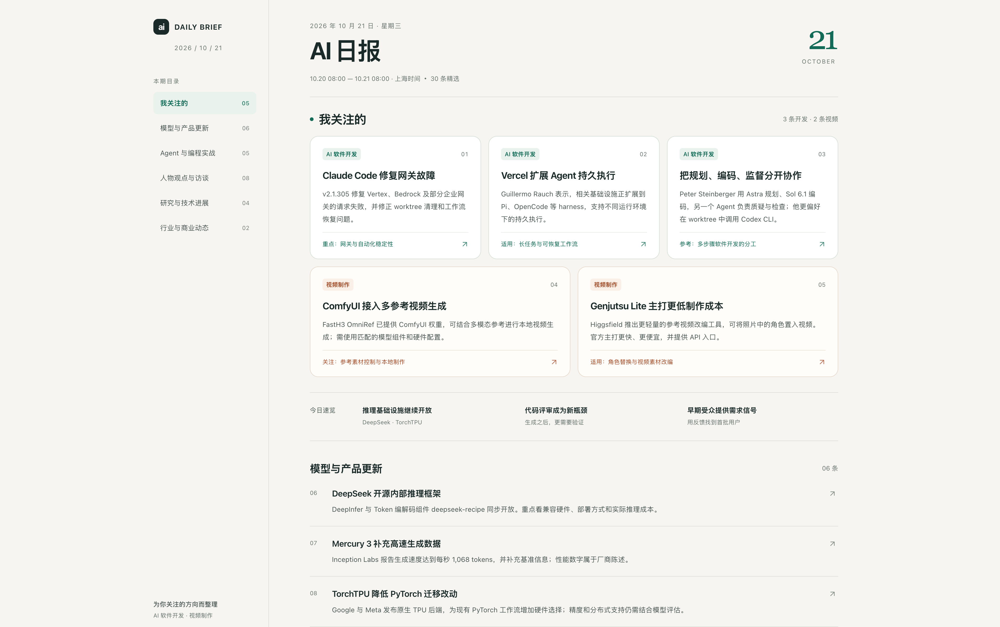

# AIStuff · AI 有用的东西

收集可以直接复用的 AI 提示词、工作流和小工具，从解决具体问题开始。

## AI 日报

用一段提示词，搭建每天自动整理的个性化中文 AI 日报。

- 每天上海时间 **08:00** 交付，去重后尽量约 **30 条**。
- 兼顾新闻、人物观点、访谈、工程实践和研究进展。
- **“我关注的”置顶最多 5 条**，默认关注 AI 软件开发、视频制作，可自行修改。
- 按主题分类，保留出处链接，并生成简洁易读的 **HTML 报告**。

### 使用

打开 **[完整创建提示词](ai-daily/prompt.txt)**，复制全文，发送给支持联网和定时任务的 AI 应用。应用会按提示词接入信息源、生成一期样例并创建每日任务；具体交付能力取决于所用应用。

信息源：[AIHOT](https://aihot.news/agent)、[Follow Builders](https://github.com/zarazhangrui/follow-builders)，以及关注方向的官方更新。

### 效果预览

截图展示一期日报的阅读效果，实际内容与排版由使用的应用生成。
